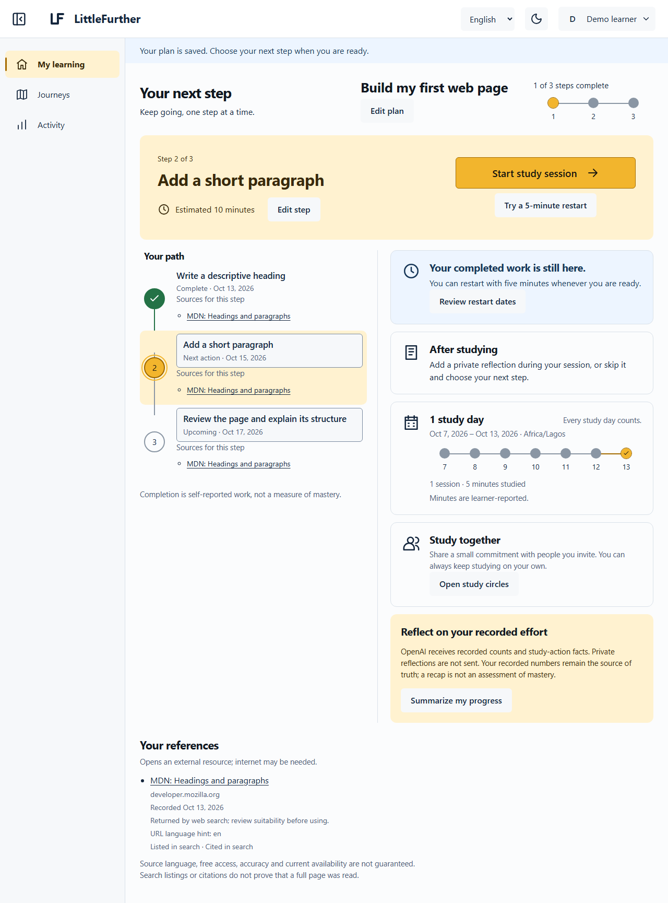
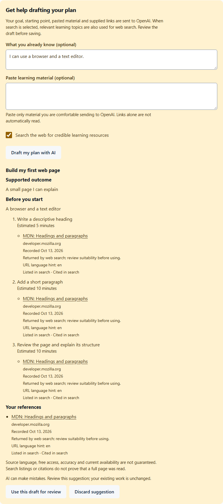
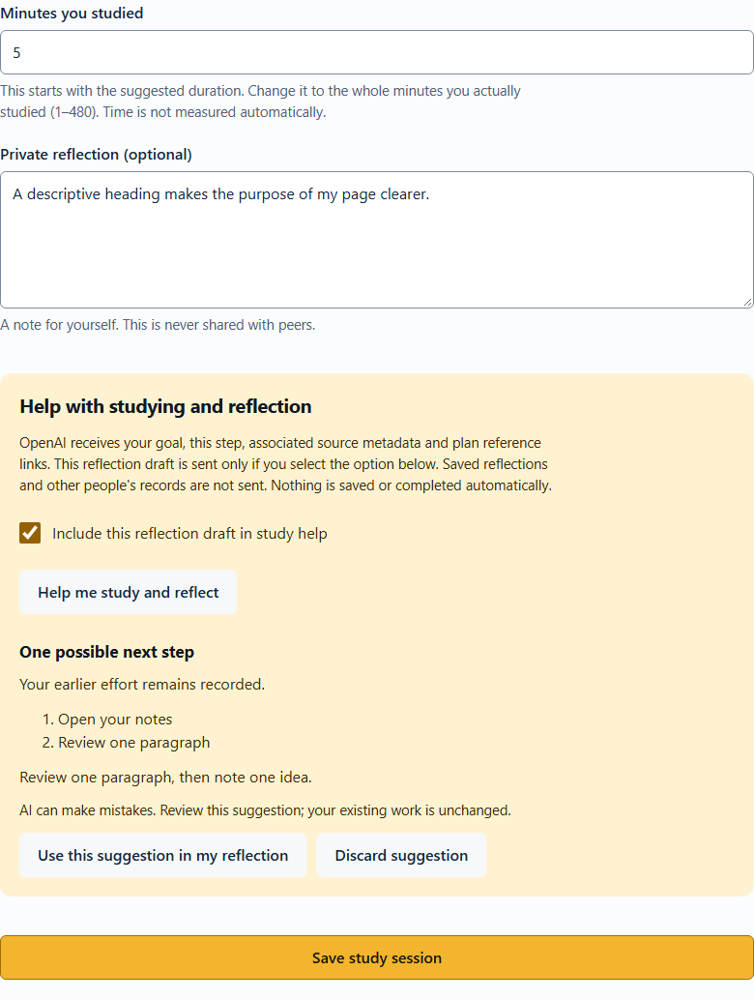
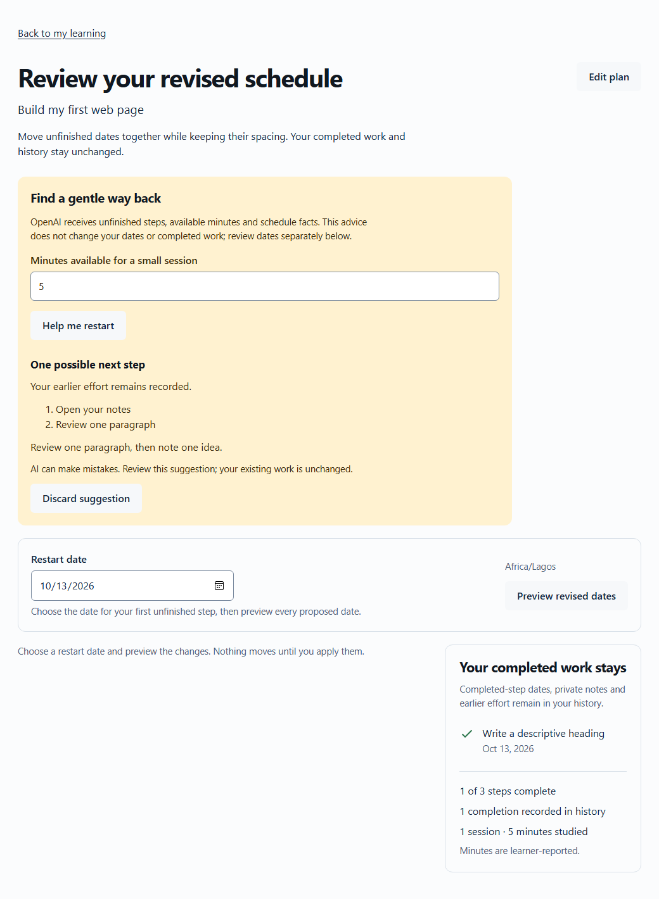
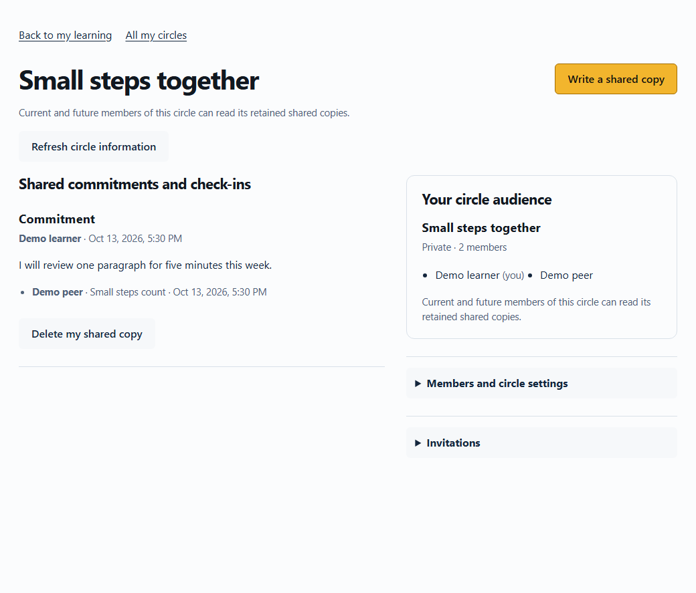
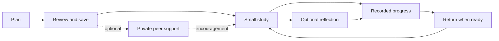
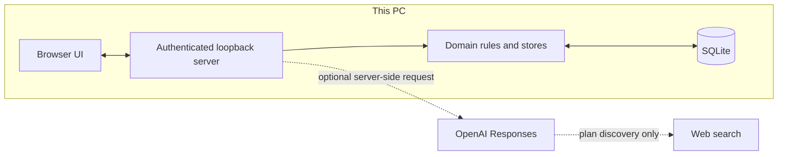

<div align="center">
  <picture>
    <source media="(prefers-color-scheme: dark)" srcset="docs/assets/littlefurther/brand-dark.svg">
    
  </picture>

# LittleFurther

**Andela × Miva × OpenAI Codex Accelerator Capstone**

**Keep learning, even when life interrupts.**

[Experience](#a-learning-journey-you-can-return-to) · [Run locally](#run-locally) · [Architecture](#how-it-fits-together) · [Documentation](docs/README.md)

</div>

<picture>
  <source media="(prefers-color-scheme: dark)" srcset="docs/assets/littlefurther/dashboard-dark.png">
  
</picture>

*Actual application interface · synthetic demo data · mocked AI/search responses. [Both themes and complete gallery](docs/README.md#screenshot-gallery).*

## A learning journey you can return to

Starting a course is one thing; finding space to keep studying is another. Competing responsibilities, unclear next actions and interruptions can make returning feel harder than starting. LittleFurther brings planning, small study sessions, recorded effort and optional support into one journey, so earlier work stays visible when a learner returns.

It is designed for learners across courses, certifications and independent study. This local proof of concept demonstrates what they can do; improved motivation, retention or mastery still needs evidence from real learners.

| Connected capability | What you can do |
| --- | --- |
| **TinySteps** | Build an editable plan from a curated template, your own topics or an optional AI draft. Review actions, estimates, dates and resources before saving. |
| **StudyCircle** | Study in small sessions, optionally reflect, and separately mark an action complete. Invite trusted peers into private circles for commitments, check-ins and preset encouragement. |
| **Comeback** | Start with five minutes or preview revised dates. Explicitly confirm schedule changes while completed work and earlier history remain intact. |
| **Flexible consistency** | See study days and accumulated effort without a punitive streak. Adjust your pace and availability. |
| **FinishLine** | Recognize completion of the plan’s active steps, then choose another goal. Completion is self-reported activity, not an assessment or certificate. |

English and French interfaces, light and dark themes, and responsive navigation support the same experience. Learner-authored text and external resources retain their original language.

<details>
<summary><strong>See planning, study, returning and private support</strong></summary>

### Review a plan



*Actual application interface · synthetic demo data · mocked AI/search responses. Suggestions are reviewed before plan saving.*

### Study and reflect



*Actual application interface · synthetic demo data · mocked AI/search responses. Saving study and completing a step are separate.*

### Return after a break



*Actual application interface · synthetic demo data · mocked AI/search responses. Previewing or requesting advice does not confirm new dates.*

### Choose private support



*Actual application interface · synthetic demo data · mocked AI/search responses. Two local accounts demonstrate deliberate sharing, not remote connectivity.*

</details>

## Your journey



AI help sits inside existing tasks: draft a plan, make a step smaller, study and reflect, restart, recap recorded progress, or phrase your own circle message. Plan drafting can deliberately search for resources. Suggestions remain advisory; applying a draft, saving work, completing a step, confirming dates and sharing a copy remain distinct learner actions.

## Run locally

With Docker Desktop's Linux engine or Linux Docker Engine28+ and Compose, clone this repository and run:

```bash
docker compose up --build -d
```

Open **http://127.0.0.1:4317**. Docker builds the pinned runtime locally and keeps fresh private records in a named volume. No host Node/pnpm or AI key is needed. See [Docker setup, optional AI, alternate ports and stopped backups](docs/operations/docker.md) and [actual platform verification](docs/specs/capstone/increments/docker-verification.md). Initial building downloads the base image/packages; no project-image publication or hosting is configured.

For native development instead:

Use **Node 24.19.0** and **pnpm 11.19.0**. Clone this repository:

```powershell
git clone https://github.com/MikeIronSyd/littlefurther.git
cd littlefurther
node --version
pnpm --pm-on-fail=download --version
pnpm --pm-on-fail=download install --frozen-lockfile --ignore-scripts
pnpm --pm-on-fail=download run build
pnpm --pm-on-fail=download start
```

Open **http://127.0.0.1:4317** and keep the terminal running. Create a local account, confirm your timezone, then create and review a plan. The email is a login identifier; this version does not send verification emails or recover passwords. After source edits, stop, rebuild and restart.

The manual core works without internet while the local server runs. Installation may need network access; AI, search and external resource pages do. Operators can configure an existing OpenAI key server-side in the ignored `.local/ai-provider.env`; no key is required to use manual workflows. See [configuration, isolation and recovery guidance](docs/operations/local-demo.md) before using learner data. Never commit credentials or the data directory.

## How it fits together



Strict TypeScript and native browser modules are bundled with Vite. Node/Express serves the same-origin interface; Better Auth manages local sessions, and SQLite stores canonical private records. The key stays on the server. Browser storage holds only theme/sidebar preferences.

Each AI action discloses its outbound context and validates ownership, output and staleness. Circle assistance receives only the learner’s own typed draft, message kind and language. Search-source metadata is temporarily staged for 24 hours; a separate plan save retains source snapshots. `store:false` is used without promising zero provider retention. [Detailed architecture and AI/privacy flow](docs/ARCHITECTURE.md).

## Explore further

- [Complete user guide](docs/USER_GUIDE.md): every current feature and limitation.
- [Development guide](docs/DEVELOPMENT.md): pinned checks, template/translation adaptation and the Codex review workflow.
- [Dated verification](docs/specs/capstone/increments/ai-assistance-verification.md#actual-executed-checks): 13 October’s 85 domain/server and 94 browser passes, plus scoped review. These are local results; hosted CI is not active.
- [Specification and future work](docs/specs/capstone/spec.md): requirements, operating constraints and prototype boundaries.
- [Hackathon evidence](docs/specs/capstone/verification.md): Codex’s planning, building, review and documentation artifacts mapped to the four judging criteria.

Michael approved the implemented visual baseline in [D016](docs/specs/capstone/design.md#overall-design-approval--12-october-2026). Later AI surfaces and the timed 3–5 minute video remain separate review/delivery work. Public hosting, remote-peer access, synchronization and production readiness are outside this local prototype. The next development stage should validate learner usefulness and address deployment, account recovery and operational safeguards before broader adoption.
