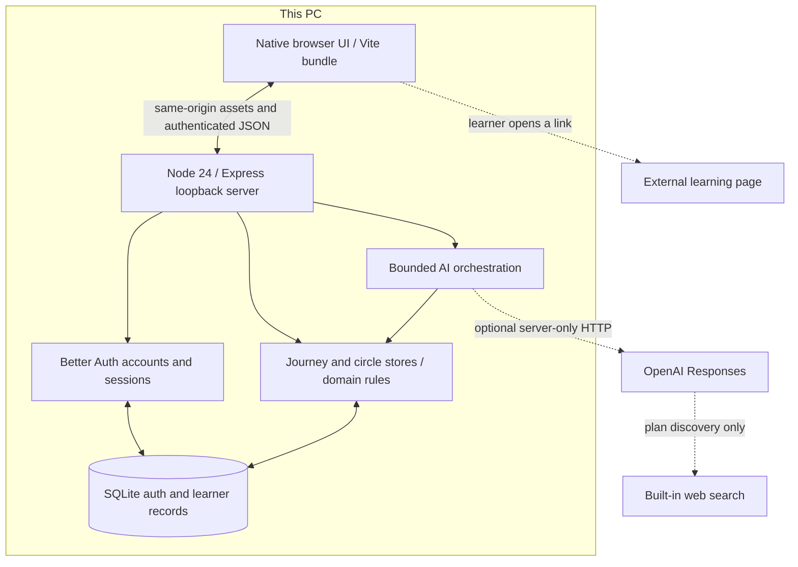
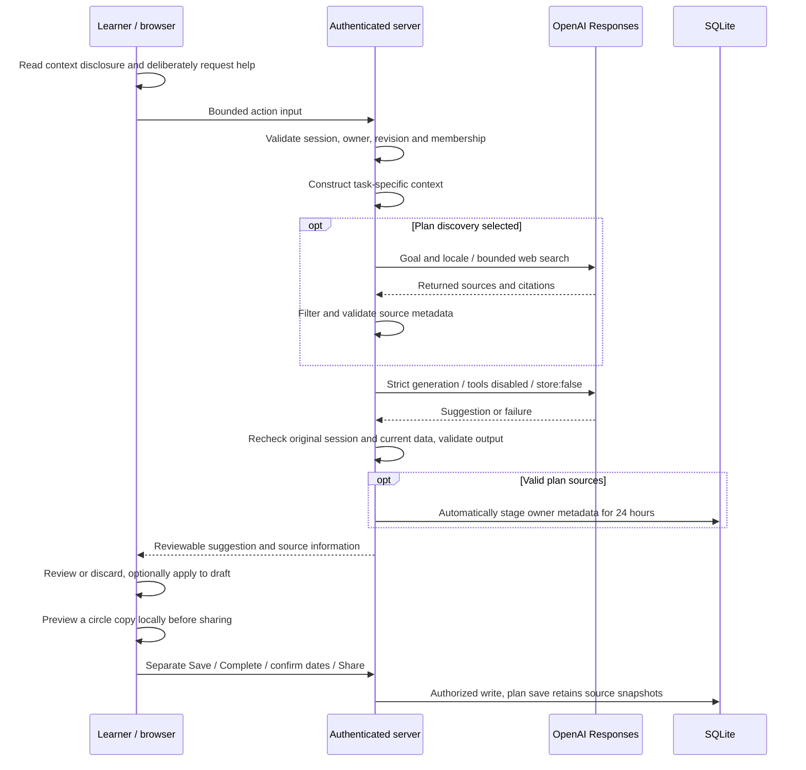

# LittleFurther architecture

LittleFurther is a local browser proof of concept. Browser and loopback server run on one PC; SQLite is canonical. There is no hosted deployment, cross-device synchronization or remote-peer demonstration.

## System overview

The manual core works without internet while the server runs. AI, search and external reference pages need internet. The app itself does not fetch arbitrary pages or extract PDFs.

### Optional Docker packaging

[Docker clone-and-run](operations/docker.md) packages the same compiled client/server and production dependencies in a pinned Linux Node image. The native browser connects to host127.0.0.1 with equal host/container ports. The listener uses0.0.0.0 inside Docker; canonical127.0.0.1 Host/Origin checks remain unchanged, and native startup still defaults to127.0.0.1. A nonroot process uses one named volume for the complete SQLite/auth directory. An optional read-only key-file mount enables existing AI; keys/data are excluded from builds. No service, schema or API is added. [Actual platform/lifecycle checks](specs/capstone/increments/docker-verification.md) qualify portability claims.

## Actual source responsibilities

| Path | Responsibility |
| --- | --- |
| `src/client/` | Native DOM screens, localized copy, editor, study, Comeback, Activity, circles, shell/preferences and contextual AI review controls. `learning-lifecycle.ts` coordinates archive/deletion/correction/recovery confirmations and read-only archived views. |
| `src/domain/` | Validation and deterministic learning/circle/AI rules, progress/date calculations, templates and source constraints. |
| `src/server/app.ts` | Same-origin routes, authentication/authorization, input validation and orchestration. |
| `src/server/store.ts`, `circles.ts` | SQLite migration/private journey and circle persistence, transactional writes and retry receipts. |
| `src/server/ai-assistance.ts` | Necessary action context, owner/revision/member checks, concurrency/cancellation/deadlines and post-I/O rechecks. |
| `src/server/ai-provider.ts` | Native Responses HTTP, fixed model/tools, structured output and search-source extraction. |
| `src/server/ai-sources.ts` | Owner-scoped temporary source metadata, expiry and resolution; `store.ts` retains snapshots during explicit plan saving. |
| `src/server/index.ts` | Loopback startup, configuration and server-only credential loading. |
| `src/shared/` | Browser/server DTOs and six-action AI contracts. |
| `tests/`, `tools/` | Domain/server/browser tests and distinct-process verification. |
| `docs/specs/`, `.agents/skills/` | Requirements, dated evidence and reusable review/reconciliation workflows. |

Server modules orchestrate domain/store logic; no separate `src/application` layer or extra service exists. TypeScript contracts do not replace runtime input/output validation.

## AI and privacy request flow

Six actions cover plans, smaller steps, study/reflection, Comeback, progress recap and circle wording. Search is available only for deliberate plan discovery. There is one generation request and at most one bounded search request, without automatic retries or provider/model fallback.

The pinned model is `gpt-5.4-mini-2026-03-17`. One operator-managed server key powers the app; there is no user-key entry, purchase, top-up or user quota feature. `CAPSTONE_AI_DISABLED=1` bypasses credential loading. `store:false` does **not** guarantee zero provider retention; see the [AI contract](specs/capstone/increments/ai-assistance.md) and [OpenAI data controls](https://developers.openai.com/api/docs/guides/your-data).

Circle generation receives only the learner’s typed own draft, kind and locale. Circle IDs support local checks and are not sent to the provider. Peer posts, saved reflections and private plans are excluded. Study help includes the current reflection draft only after selection; progress recaps exclude saved reflections. Point-of-use disclosures explain the necessary context.

Server post-I/O checks and browser session/input lifetime guards reject stale suggestions. Errors, refusals, exhausted credits, disconnection and cancellation retain inputs and leave manual controls available. Cancellation cannot guarantee that already-started provider processing or charges stop.

## Persistence and boundaries

Accounts/sessions and private records live in ignored local SQLite with a persistent authentication secret. Browser storage holds only validated theme/sidebar preferences. Local persistence is not encrypted backup or synchronization.

Schema v3 adds source drafts to the v1/v2 store. Metadata is bounded, owner-scoped and expires after 24 hours; separate successful plan saving copies exact source snapshots into retained plan JSON. Cleanup does not delete saved snapshots. Listed/cited/opened labels describe returned search evidence, not independent accuracy, free access or full-page reading. Supplied links remain unverified unless actually consulted.

Study saving does not complete a step. Comeback shifts unfinished dates only after preview/confirmation. Circle sharing creates a separate explicit copy; later private edits do not update it. Revisions, write receipts and transactions protect these workflows. [Operations](operations/local-demo.md) covers complete data-directory isolation and matching-source rollback.

### Archive, deletion and recovery

The [lifecycle contract](specs/capstone/increments/learning-lifecycle.md) adds backward-compatible JSON metadata without a new SQL table: absent `archivedAt` means active, absent `correctedAt` means an effective completion, and scope-event kind distinguishes editing from restoration. Active/archived lists are owner-scoped. Archived details and history remain readable; content writes and saved-plan AI are rejected until restoration. Restore keeps the original schedule. Delayed AI responses recheck the current lifecycle and revision before they can be used.

Every learning-data mutation, including recording study, requires a request identity and current revision and advances the revision once. Exact retries do not repeat the mutation. New journey receipts contain minimal plan references instead of copied private plan/history responses; replay returns the current authorized state. Legacy receipts are read compatibly. Session/reflection deletion converts matching legacy snapshots into content-free references in the same transaction. Whole-plan deletion removes the plan and its activity/completion/scope rows atomically, with minimal retry markers preventing old requests from recreating deleted content.

Session deletion changes recorded minutes, sessions and study days without changing completion. Reflection-only removal retains its session. Completion correction retains a visibly corrected event outside totals and cannot clear a newer completion. Removed-step recovery uses the latest saved scope snapshot, preserves step identity/date, derives completion from the current ledger and appends the step. Associated historical sources and explicitly selected additional links are validated locally; restoration neither fetches pages nor requires unexpired AI staging, and never replays deleted study records.

Circle copies remain independent when a private plan or record is deleted. Own-encouragement withdrawal targets the current encouragement ID; a fresh update rotates that ID so an old withdrawal cannot remove a newer contribution. Existing circle closure remains destructive, without a reversible archive. App deletion does not claim secure disk erasure, backup purge or recall of previously processed provider requests. [Lifecycle verification](specs/capstone/increments/learning-lifecycle-verification.md) records actual checks and remaining gates separately from these implementation details.

## Evidence and future work

[13 October verification](specs/capstone/increments/ai-assistance-verification.md) records actual checks and limits. The [specification](specs/capstone/spec.md) governs future decisions. Public/TLS deployment, email/recovery, remote peers, encrypted backups, moderation and operational observability require additional work; the diagram does not imply those services exist.
