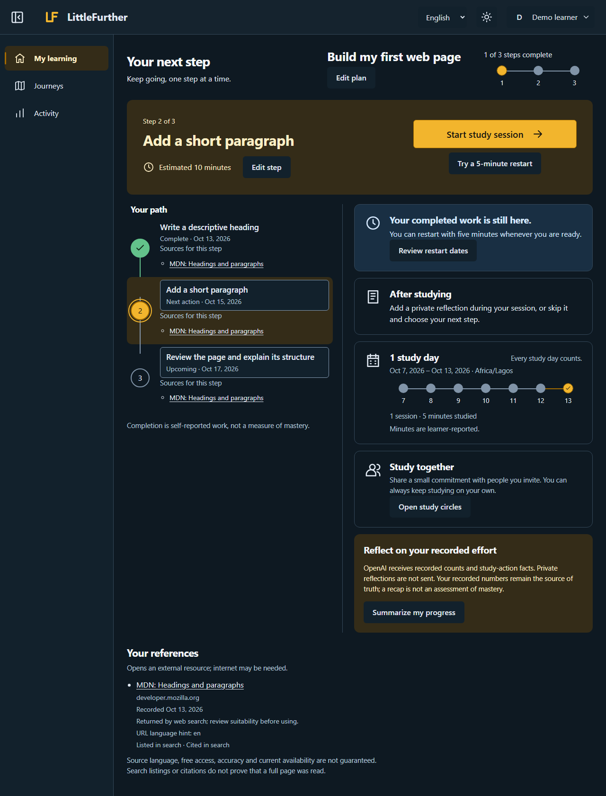
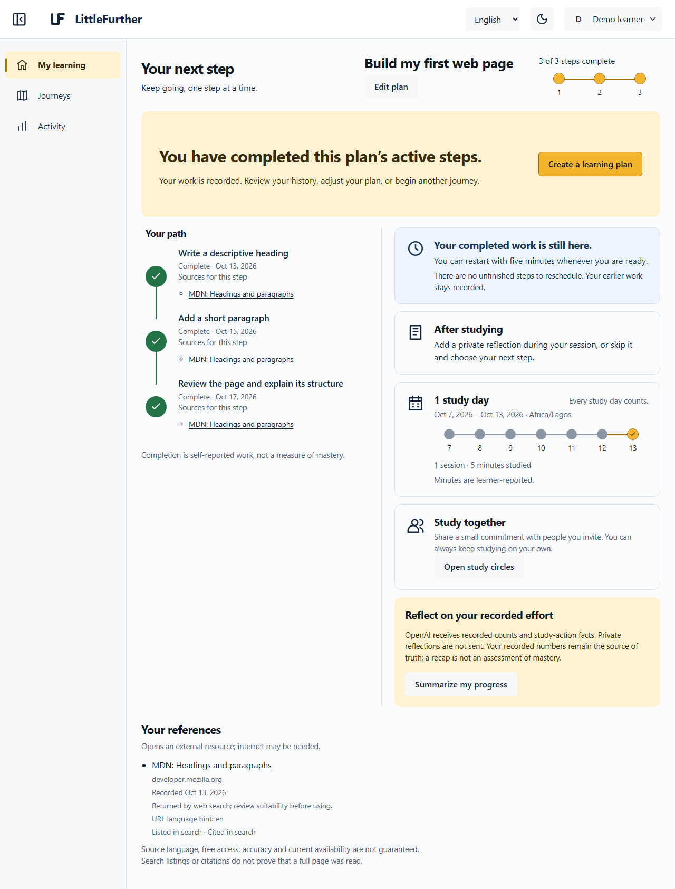
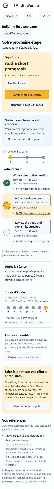

# LittleFurther documentation

Start with the path that matches what you want to do. These guides describe the current local proof of concept; dated records preserve what was actually checked.

| Reader | Start here | Continue with |
| --- | --- | --- |
| Learners | [Complete user guide](USER_GUIDE.md) | [Local setup and account limits](operations/local-demo.md), gallery below |
| Developers | [Development](DEVELOPMENT.md) | [Architecture](ARCHITECTURE.md), [specification](specs/capstone/spec.md), [research](specs/capstone/research.md) |
| Judges and reviewers | [Product introduction](../README.md) | [Judging evidence](specs/capstone/verification.md), [AI checks](specs/capstone/increments/ai-assistance-verification.md#actual-executed-checks), [plan](specs/capstone/plan.md) |

## Current status and evidence

The local connected journey and six optional AI actions are implemented. The 13 October [AI verification](specs/capstone/increments/ai-assistance-verification.md) records 85 domain/server and 94 browser passes, independent source review and bounded visual observations. These are dated results at the recorded revision, not tests rerun for this documentation increment.

[D016](specs/capstone/design.md) records Michael’s 12 October approval of the implemented visual baseline. Original reference boards and later AI surfaces have their own scope; technical checks and screenshots do not establish learner outcomes, production readiness or a completed video. The 3–5 minute demo and learner validation remain unfinished.

## Screenshot gallery

Every capture below is an **actual application interface, synthetic demo data, mocked AI/search responses**. A fresh isolated local database and injected provider responses avoid real-key loading or live OpenAI calls. [Provenance and dimensions](assets/littlefurther/provenance.md) · [Machine-readable receipt](assets/littlefurther/capture-receipt.json).

### Dashboard — light

### Dashboard — dark

### Planning and source review

This focused capture shows a suggestion before applying or saving. Search labels, sources and prose are fixtures, not live research results.

### Study and reflection

The current reflection draft is sent to the mocked provider after its option is selected. Study saving and whole-step completion remain separate.

### Comeback

Advice does not change dates. The learner separately requests a preview and confirms schedule changes.

### Private support

Two synthetic local accounts join through a one-use invitation. A commitment is previewed/shared; the peer adds preset encouragement. This demonstrates local account separation, not remote connectivity.

### FinishLine

The synthetic learner marks every step complete. This records activity, not certification or assessed mastery.

### Successful French mobile journey

The interface is French. Learner-authored goal/step text remains English; automatic content translation is not implied.

## Engineering and project records

- [Architecture](ARCHITECTURE.md): actual folders, system boundary and AI/privacy sequence.
- [Development](DEVELOPMENT.md): checks, adaptation and reusable review/evidence workflows.
- [Operations](operations/local-demo.md): configuration, local data, isolation, failures and recovery.
- [Specification](specs/capstone/spec.md), [research](specs/capstone/research.md), [plan](specs/capstone/plan.md) and [verification](specs/capstone/verification.md).
- [Design decisions](specs/capstone/design.md) and original [brand artwork](specs/capstone/designs/littlefurther/README.md).
- [Presentation contract](specs/capstone/increments/repository-presentation.md) and [checks/delivery](specs/capstone/increments/repository-presentation-verification.md).

Historical records retain their dates and evidence boundaries. Active summaries describe current behavior; old proposals do not silently become current requirements.
