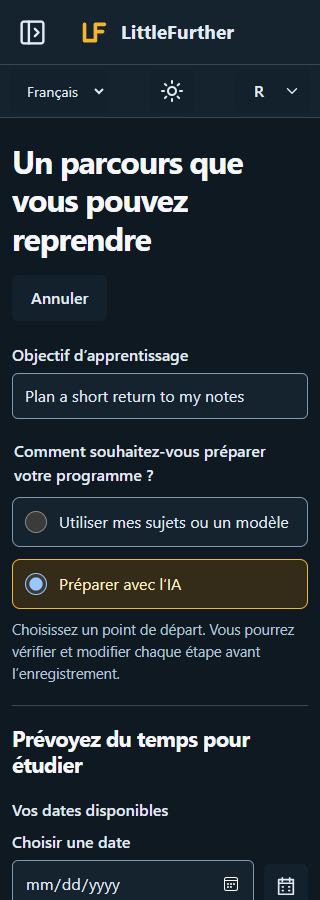

# LittleFurther UI refinement references

## Goal

Show the proposed 17 October 2026 refinement before application implementation: clearer single-page drafting, quieter optional assistance, primary learning records and contextual management.

## Context Pointers

- [Combined reference board](board.png) and [editable board](board.html).
- [Editable standalone reference](reference.html), opened with `?surface=planning&theme=light`; surfaces are `planning`, `study`, `activity` and `journeys`.
- [Capture provenance and mechanical results](reference-provenance.json) record the source revision, input hashes, native dimensions and checks.
- Source baseline: `ee61b7d2f719aaca7559a6a9faee72afb6a855d2`. The selected A Original LF geometry, Amber/ink palette and Segoe UI stack come from the incumbent design system.

| Surface | Desktop, 1440px, light | Mobile, 320px, dark |
| --- | --- | --- |
| Planning | [Reference](planning-desktop-light.png) | [Reference](planning-mobile-dark.png) |
| Study | [Reference](study-desktop-light.png) | [Reference](study-mobile-dark.png) |
| Activity | [Reference](activity-desktop-light.png) | [Reference](activity-mobile-dark.png) |
| Journeys | [Reference](journeys-desktop-light.png) | [Reference](journeys-mobile-dark.png) |

## Constraints

These are **synthetic pre-implementation design references**, not screenshots of the running application. The HTML contains illustrative records, dates and source metadata. No application server, learner database, provider request, live search or external asset was used. Existing product wording is reused where applicable; drafting-choice labels, management summaries and counted-completion guidance illustrate proposed UX wording.

- Planning shows the AI route selected, shared scheduling, optional secondary details, an explicit recipient disclosure, three editable reviewed steps, associated source links and a single source catalogue.
- Study groups minutes, reflection and saving before optional assistance. Step completion remains separate.
- Activity keeps saved records visible, exposes management through native disclosures and presents corrected completion neutrally.
- Journeys keeps Open prominent. Its visible archive confirmation is a sibling outside collapsed management content, illustrating that collapsing triggers must not hide a confirmation or uncertain-write recovery.

The static controls illustrate layout and native affordances; they do not implement application actions. Closed disclosure content is not part of the visible-target assertion. The English-only references do not establish French, enlarged-text or assistive-technology acceptance, accessibility conformance, learner outcomes or human design approval. Those belong to the implementation verification.

Root inspected the combined board and full desktop planning reference before frontend edits on 17 October. The planning illustration's simplified start-date/minutes fields and collapsed availability are layout placeholders, not approved behavior changes: implementation retains the existing visible availability calendar, date chips and weekly capacity controls. The contract also governs the final wording and places AI context inside optional details. These differences do not authorize new controls or hiding required scheduling.

## Done When

The local installed Edge/Playwright rendering produced all eight PNGs and the board. All eight cases passed the recorded mechanical checks: no horizontal overflow, complete `LittleFurther` text and at least 44×44px for visible buttons, summaries, selects, text/number/date inputs, textareas and radio/checkbox label targets. The initial mechanical capture and one bounded icon-geometry correction/confirmation are recorded in the parent increment; actual application checks remain separate.

Impeccable's incumbent-world/craft/layout guidance and the UI/UX companion accessibility checklist informed these references. The ignored local renderer is `.local/ui-refinement/reference-render.mjs`; it only reads the reference/design sources and writes this design-reference folder.

## Actual application review —17October2026

The following are **actual application interfaces, isolated synthetic records, mocked AI/search responses**. They are separate from the synthetic precode boards above. The capture manifests retain viewport dimensions, source/build hashes, content classification and actual check results. The ordinary learner database and real provider key were not used. Capture/inspection servers are stopped.

The initial24capture slots cover authentication, first-use preferences, planning, dashboard, study, Activity, Comeback, private circles, FinishLine and Journeys at1440px English/light and320px French/dark, plus focused plan review,200% root-text/forced-colour preferences and a touch drawer. The compact contact boards orient the review; they are not a substitute for full-size originals or interactions:

- [Entry/preferences/planning](app-contact-1.png).
- [Learning/study/Activity](app-contact-2.png).
- [Comeback/private circles/FinishLine](app-contact-3.png).
- [Journeys/review/accessibility conditions](app-contact-4.png).
- [Initial capture manifest](app-initial-captures.json), [touch follow-up](app-touch-followup-captures.json) and [contact-sheet hashes](app-contact-sheets.json).

These initial captures deliberately remain **pre-correction evidence**. Root's combined inspection found oversized drafting radios and untranslated visible contextual buttons after a locale switch. One correction batch fixed those defects; one focused confirmation produced:

| Affected view | Corrected capture |
| --- | --- |
| Manual drafting, desktop English/light | [Planning](app-confirmation-planning-desktop-light-en.png) |
| AI route,320px French/dark | [Planning](app-confirmation-planning-mobile-dark-fr.png) |
| Open management/confirmation, English/light | [Journeys](app-confirmation-journeys-desktop-light-en.png) |
| Collapsed triggers with visible confirmation, French/dark | [Journeys](app-confirmation-journeys-mobile-dark-fr.png) |
| Cancel reopens management and returns focus | [Journeys](app-confirmation-journeys-cancel-reopened-en.png) |

The [confirmation manifest](app-confirmation-captures.json) records22×22px radio glyphs inside384×50px desktop/296×50px mobile labels, translated visible text and accessible names, independent confirmation visibility and Cancel focus. Its final whole-plan hash assertion was invalid: existing language preference saving changes plan locale/updatedAt. Both hashes are recorded, but raw before/after records were not retained for a field-by-field comparison, so that run **does not establish exact learning-record invariance**; the original harness failure remains recorded. No plan-endpoint write, AI assistance or external request was observed during confirmation.

The initial touch setup incorrectly tried a background theme control while the modal drawer made it inert; a follow-up also corrected a saved-French-label assumption and then passed. These are harness failures, not app defects. Initial focused mobile element capture includes a fixed skip-link stitching overlay; viewport clips naturally omit lower content. The manual review is bounded, not a complete language/theme/device cross-product, real-device or screen-reader assessment. See [actual verification and limitations](../../increments/ui-refinement-verification.md); no new human design approval or educational outcome is implied.
